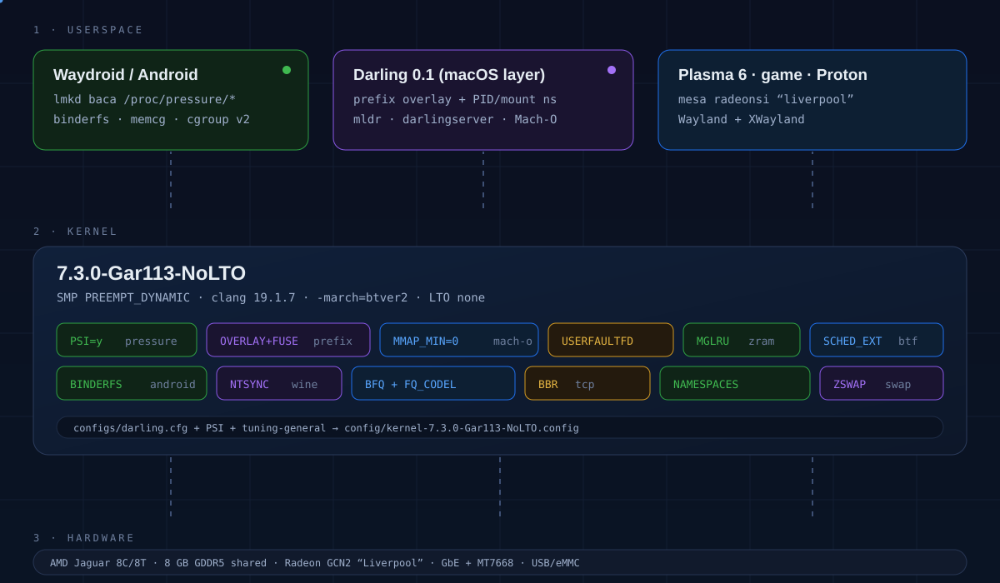
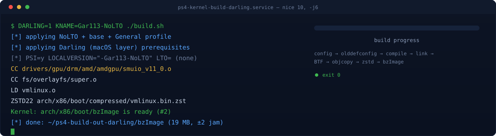
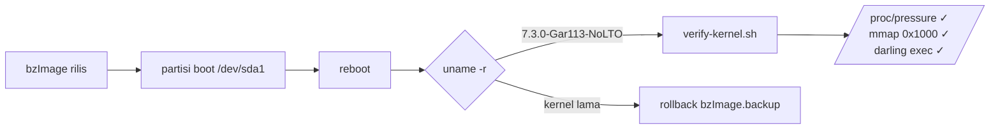

<div align="center">
  
</div>

<div align="center">
  
</div>

<p align="center">
  <a href="https://github.com/Gar113/kernel-linux-7.3.0-aoeulia/releases/latest"></a>
  
  
  
  
  
  <a href="https://github.com/Gar113"></a>
  <a href="LICENSE"></a>
</p>

<p align="center">
  <sub>PS4 Linux “Strawberry” · AMD Jaguar 8C · 8 GB GDDR5 shared · Radeon GCN2 “Liverpool”</sub>
</p>

---

## Kenapa kernel ini ada

Dua masalah, satu kernel:

<table>
<tr>
<td width="50%" valign="top">

**🧠 PSI untuk lmkd**
Android (Waydroid) butuh `/proc/pressure/*` supaya `lmkd` bisa membunuh proses
berdasarkan **tekanan memori**, bukan ambang buta. Di mesin 8 GB yang memorinya
dipakai bersama GPU, ambang buta itu terlalu cepat salah bunuh.

`CONFIG_PSI=y` · `PSI_DEFAULT_DISABLED=n`

</td>
<td width="50%" valign="top">

**🍎 Prasyarat Darling**
Darling 0.1+ tidak lagi memakai kernel module — Mach/XNU diemulasi di userspace
(`darlingserver` + `mldr`). Kernel cuma perlu namespace, overlayfs, `mmap_min_addr=0`,
dan beberapa syscall yang sebelumnya dimatikan.

`configs/darling.cfg` · 13 simbol

</td>
</tr>
</table>

<div align="center">
  
</div>

## Isi kotak

| | Fitur | Status | Kenapa |
|:--|:--|:--|:--|
| 🧠 | PSI (`/proc/pressure`, `memory.pressure`) | `y` | lmkd Android / Waydroid |
| 🍎 | Namespaces + overlayfs prefix | `y` | `~/.darling` ala container |
| 📉 | `DEFAULT_MMAP_MIN_ADDR=0` | `0` | Mach-O lama map `__TEXT` di `0x1000` |
| 🧩 | `userfaultfd`, `memfd`, `process_vm_readv` | `y` | `darlingserver` |
| 🧱 | `overlayfs`, `fuse`, `loop`, `tmpfs_xattr` | `y` | prefix + DMG/image |
| 🕹️ | `binderfs` | `y` | Waydroid |
| ⚡ | `SCHED_CLASS_EXT` + `DEBUG_INFO_BTF` | `y` | scheduler userspace (`scx_*`) |
| 🧮 | MGLRU + `zram` + `zswap` | `y` | bertahan di 8 GB |
| 🎛️ | `PREEMPT_DYNAMIC`, `HZ=250`, BFQ, `fq_codel` | `y` | latency vs overhead |
| 🌐 | `BBR`, `wireguard`, `veth`/`bridge`/`tun` | `y` | jaringan |
| 🍷 | `NTSYNC` | `y` | sinkronisasi thread Wine/Proton |
| 🧬 | `IA32_EMULATION` + `COMPAT_32BIT_TIME` | `y` | app 32-bit |

<details>
<summary><b>Lihat tabel config lengkap (yang berubah / penting)</b></summary>

| Symbol | Nilai | Alasan |
|:--|:--|:--|
| `CONFIG_LOCALVERSION` | `"-Gar113-NoLTO"` | nama kernel via `KNAME`, tanpa `+` |
| `CONFIG_PSI` | `y` | `lmkd` Android |
| `CONFIG_PSI_DEFAULT_DISABLED` | `n` | aktif sejak boot |
| `CONFIG_DEFAULT_MMAP_MIN_ADDR` | `0` | kompat Mach-O lama |
| `CONFIG_USERFAULTFD` | `y` | sebelumnya mati |
| `CONFIG_NAMESPACES` + `{UTS,IPC,PID,NET,USER}_NS` | `y` | containerization Darling |
| `CONFIG_OVERLAY_FS`, `CONFIG_TMPFS_XATTR` | `y` | prefix overlay |
| `CONFIG_MEMFD_CREATE`, `CONFIG_CROSS_MEMORY_ATTACH`, `CONFIG_KCMP` | `y` | `darlingserver` |
| `CONFIG_BINFMT_MISC`, `CONFIG_SECCOMP_FILTER` | `y` | loader + sandbox |
| `CONFIG_IA32_EMULATION`, `CONFIG_COMPAT_32BIT_TIME` | `y` | app 32-bit |
| `CONFIG_FUSE_FS`, `CONFIG_BLK_DEV_LOOP` | `y` | image / DMG |
| `CONFIG_DEBUG_INFO_BTF`, `CONFIG_SCHED_CLASS_EXT` | `y` | sched_ext |
| `CONFIG_LRU_GEN`, `CONFIG_ZRAM`, `CONFIG_ZSWAP` | `y` | manajemen memori |
| `CONFIG_ANDROID_BINDERFS` | `y` | Waydroid |
| `CONFIG_NTSYNC` | `y` | Wine/Proton |
| `CONFIG_HZ`, `CONFIG_PREEMPT_DYNAMIC` | `250`, `y` | latency |
| `CONFIG_IOSCHED_BFQ`, `CONFIG_DEFAULT_NET_SCH` | `y`, `fq_codel` | storage + net |
| `CONFIG_TCP_CONG_BBR` | `y` | congestion control |

Config utuh: [`config/kernel-7.3.0-Gar113-NoLTO.config`](config/kernel-7.3.0-Gar113-NoLTO.config)

</details>

## Dokumentasi

| Dokumen | Isi |
|:--|:--|
| 📘 [**Fitur kernel**](docs/FEATURES.md) | PSI, prasyarat Darling, MGLRU/zram, `PREEMPT_DYNAMIC`, sched_ext, io_uring, BBR, NTSYNC, binderfs, trade-off `mmap_min_addr=0` — lengkap dengan perintah verifikasi |
| 🔩 [**Dukungan hardware**](docs/HARDWARE.md) | Jaguar, Liverpool 18 CU, 8 GB GDDR5 shared, SATA/AHCI, SD8797 WiFi, Yukon GbE, xHCI, HDMI/USB audio, sensor, cmdline boot, tabel jalan/belum |
| 📊 [**Benchmark**](docs/BENCHMARKS.md) | CPU (OpenSSL/7z/zstd), memori, disk, latency timer, PSI, GPU (glmark2/vkmark) — dijalankan di console ini, log mentah disertakan |

### Hasil benchmark singkat

| Area | Angka kunci |
|:--|:--|
| CPU | AES-256-GCM **765 MB/s** · SHA-256 90 MB/s · 7z **10.726 MIPS** |
| Memori | `dd` **5,7 GB/s** · tmpfs 2,0 GiB/s |
| Disk (HDD 5400 rpm) | **85 MiB/s** seq read · 54 IOPS random 4K |
| Latency | lantai timer **4 ms** (`HZ=250`) · jitter p99 4,5 ms |
| PSI | CPU **45,01** · memori **30,44** saat tekanan |
| GPU (DPM off) | glmark2 **3.072** · vkmark **5.401** |

```bash
./scripts/bench.sh     # ulangi di mesin Anda, ~3 menit
```

## Build

<div align="center">
  
</div>

Butuh source 7.3 di `~/ps4-linux-7.3` (clone [`striker91n/ps4-linux-7.3`](https://github.com/striker91n/ps4-linux-7.3),
firmware SD8797/MT7668 di `extra_firmware/`), clang/LLD 19, ±30 GB disk.

```bash
./build.sh                        # PSI + Darling, LTO none
DARLING=0 ./build.sh              # kernel PSI saja
KNAME="Gar113-NoLTO" ./build.sh   # uname -r = 7.3.0-Gar113-NoLTO
LTO=thin JOBS=8 ./build.sh        # varian lain
```

Build panjang sebaiknya sebagai systemd user unit (aman logout):

```bash
systemd-run --user --unit=ps4-kernel-build --collect \
  --property=Nice=10 --property=WorkingDirectory="$HOME" \
  --setenv=DARLING=1 --setenv=KNAME=Gar113-NoLTO \
  --setenv=OUT="$HOME/ps4-build-out" --setenv=LOG="$HOME/ps4-build.log" \
  ./build.sh
```

## Pasang

```bash
sha256sum -c SHA256SUMS --ignore-missing          # dari release
sudo mkdir -p /mnt/ps4boot
sudo mount /dev/sda1 /mnt/ps4boot
sudo cp /mnt/ps4boot/bzImage /mnt/ps4boot/bzImage.backup
sudo cp bzImage /mnt/ps4boot/bzImage
sync && sudo umount /mnt/ps4boot
# reboot console
```

Rollback: salin lagi `bzImage.backup` ke `/mnt/ps4boot/bzImage`.



## Verifikasi

```console
$ uname -r
7.3.0-Gar113-NoLTO
$ cat /proc/pressure/memory
some avg10=0.00 avg60=0.00 avg300=0.00 total=7092
full avg10=0.00 avg60=0.00 avg300=0.00 total=6953
$ sysctl vm.mmap_min_addr
vm.mmap_min_addr = 0
$ darling exec /usr/bin/basename /a/b/c.txt
c.txt
```

Otomatis: [`scripts/verify-kernel.sh`](scripts/verify-kernel.sh)

Di dalam namespace Darling:

```console
$ darling exec /bin/mount | grep overlay
overlay on /home/qba/.darling type overlay (rw,relatime,
  lowerdir=/usr/libexec/darling, upperdir=/home/qba/.darling,
  workdir=/home/qba/.darling.workdir)
```

## Known issues

<details open>
<summary><b>Darling cold start lambat</b></summary>

Run pertama setelah boot bisa >90 detik karena `launchd` start; run berikutnya
instan. Bukan hang.
</details>

<details>
<summary><b>Quadra (AppImage Roblox) segfault di Wayland — bukan kernel</b></summary>

Quadra membawa GTK 4.18.6 sendiri dan crash di Wayland native Plasma 6 + mesa 25.1:

```
kernel: quadra-rewrite[..]: segfault at 8 ... in libgtk-4.so.1
systemd: app-org.quadrahq.Quadra@..service: Failed with result 'core-dump'
```

Jalankan lewat XWayland:

```bash
GDK_BACKEND=x11 ~/.local/bin/Quadra.AppImage
```
</details>

## Struktur repo

<details>
<summary>Lihat daftar file</summary>

```text
build.sh                                  skrip build (PSI + Darling, KNAME, LTO, OUT/LOG)
configs/darling.cfg                       fragmen config prasyarat Darling
config/kernel-7.3.0-Gar113-NoLTO.config   .config hasil build (+ .sha256)
scripts/verify-kernel.sh                  cek PSI + prasyarat Darling di kernel terpasang
scripts/bench.sh                          benchmark CPU/memori/disk/latency/PSI/GPU
scripts/update-logo.sh                    ambil avatar -> regenerate branding
scripts/build-branding.py                 generator docs/logo.svg + docs/hero.svg
docs/FEATURES.md                          dokumentasi fitur + cara verifikasi
docs/HARDWARE.md                          dukungan hardware PS4 Aeolia
docs/BENCHMARKS.md                        hasil benchmark + cara ulang
docs/benchmarks/raw-2026-11-13.txt        log mentah benchmark
docs/hero.svg                             hero: Tux + Linux x PlayStation + tombol PS, marquee
docs/logo.svg                             logo GAR 113 beranimasi (cincin + orbit)
docs/gar113.svg                           wordmark "GAR 113" muncul huruf demi huruf, loop
docs/architecture.svg                     diagram hardware -> kernel -> userspace
docs/build-animation.svg                  animasi build sampai bzImage siap
AUTHORS · LICENSE · RELEASE_NOTES.md      kredit, GPL-2.0, catatan rilis
```

</details>

## Pembuat

<p align="center">
  
</p>

<table>
<tr>
<td width="96" align="center" valign="middle">
  <a href="https://github.com/Gar113"></a>
</td>
<td valign="middle">

**GAR 113** — build, uji, dan pasang langsung di console PS4 (Aeolia).

[](https://github.com/Gar113)
[](https://github.com/Gar113/kernel-linux-7.3.0-aoeulia)

</td>
</tr>
</table>

## Lisensi

Kernel dan turunannya (`config`, `System.map`, `bzImage`) mengikuti lisensi source
kernel: **GPL-2.0**. Skrip di repo ini disediakan apa adanya.

<div align="center">
  <sub>© 2026 GAR 113 · dibangun di console itu sendiri · clang 19.1.7 · ±2 jam · <code>-j6</code> nice 10</sub>
</div>
