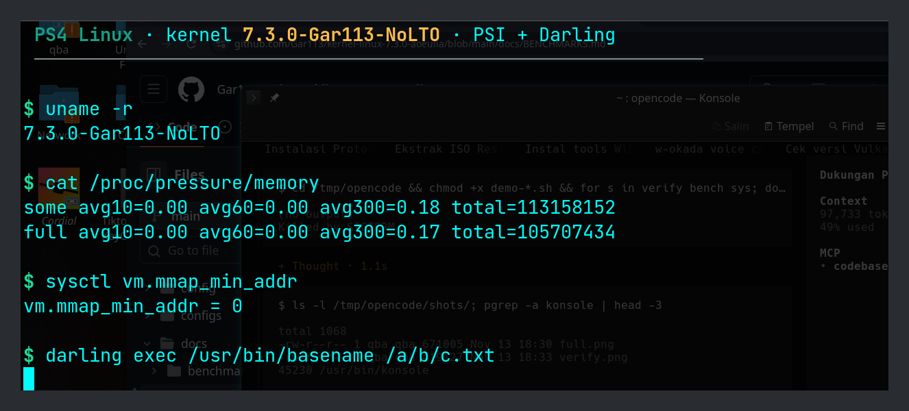
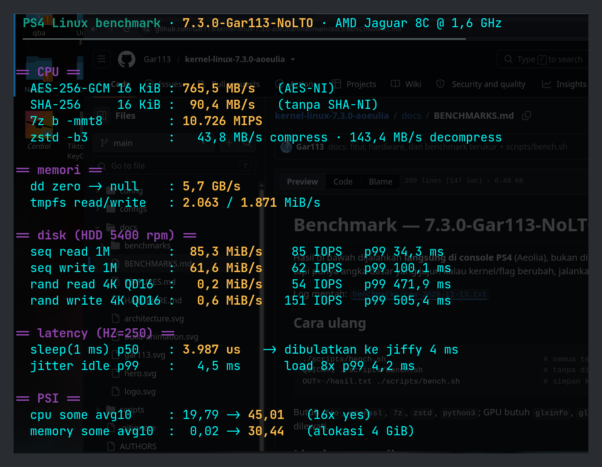

<p align="center">
  
</p>

## Kernel PS4 Linux 7.3.0 — PSI + prasyarat Darling

Build kernel untuk **PlayStation 4 (Aeolia, AMD Jaguar 8-core, 8 GB GDDR5 shared
dengan GPU)**. Dua tujuan: **PSI** untuk `lmkd` Android/Waydroid, dan **prasyarat
Darling** (layer kompatibilitas macOS) yang tidak butuh kernel module lagi sejak
Darling 0.1.

### Identitas build

Dibuat oleh **GAR 113** (<https://github.com/Gar113>), dibangun dan diuji langsung
di console PS4.

| Item | Nilai |
|---|---|
| `uname -r` | `7.3.0-Gar113-NoLTO` |
| `uname -v` | `#2 SMP PREEMPT_DYNAMIC Fri Nov 13 13:46:23 WIB 2026` |
| Source | `striker91n/ps4-linux-7.3` @ `f56b8a7c2` (Linux 7.3.0 "Strawberry") |
| Toolchain | clang 19.1.7 / LLD 19.1.7, `LLVM=1`, `-march=btver2 -mtune=btver2 -O3` |
| LTO | none |
| Build | `-j6`, nice 10, ±2 jam, di console itu sendiri |

### Asset di rilis ini

| File | Isi |
|---|---|
| `bzImage` | kernel siap pasang (19 MB, `sha256 9c2f74b4…c1ca78`) |
| `System.map.zst` | symbol map (zstd, dari 7,5 MB jadi 1,2 MB) |
| `kernel-7.3.0-Gar113-NoLTO.config` | `.config` utuh untuk reproduksi |
| `SHA256SUMS` | checksum ketiganya |

### Yang diaktifkan / diubah

- `CONFIG_PSI=y`, `CONFIG_PSI_DEFAULT_DISABLED=n` → `/proc/pressure/*` dan
  `memory.pressure` di cgroup v2 aktif sejak boot.
- `CONFIG_DEFAULT_MMAP_MIN_ADDR=0` → binary Mach-O lama yang memetakan `__TEXT`
  di `0x1000` tidak lagi kena `EPERM`. **Catatan:** ini melonggarkan satu
  mitigasi; bisa dikembalikan runtime dengan `sysctl vm.mmap_min_addr=4096`.
- `CONFIG_USERFAULTFD=y` (sebelumnya mati) dan `CONFIG_CROSS_MEMORY_ATTACH`,
  `CONFIG_MEMFD_CREATE`, `CONFIG_KCMP` untuk `darlingserver`.
- `CONFIG_NAMESPACES` + `*_NS`, `CONFIG_OVERLAY_FS`, `CONFIG_TMPFS_XATTR` untuk
  prefix `~/.darling`.
- `CONFIG_IA32_EMULATION`, `CONFIG_COMPAT_32BIT_TIME`, `CONFIG_FUSE_FS`,
  `CONFIG_BLK_DEV_LOOP` untuk app 32-bit dan image/DMG.
- Tetap aktif dari build sebelumnya: `DEBUG_INFO_BTF` + `SCHED_CLASS_EXT`
  (sched_ext), `LRU_GEN`, `ZRAM`/`ZSWAP`, `ANDROID_BINDERFS`, `NTSYNC`, `BBR`,
  `HZ=250` + `PREEMPT_DYNAMIC`, `BFQ` + `fq_codel`.

### Hasil verifikasi di console (setelah kernel dipasang)

- `uname -r` → `7.3.0-Gar113-NoLTO`, `#2 SMP PREEMPT_DYNAMIC`
- `mmap((void*)0x1000, 4096, …)` → berhasil (sebelumnya gagal `EPERM`)
- `/proc/pressure/{cpu,io,memory}` + `cgroup memory.pressure` tersedia
- `darling exec /usr/bin/basename /a/b/c.txt` → `c.txt`
- Di namespace Darling:
  `overlay on /home/qba/.darling … lowerdir=/usr/libexec/darling, upperdir=/home/qba/.darling`
- `journalctl -k -b` bersih dari oops/BUG

<p align="center">
  
</p>

### Dokumentasi

| Dokumen | Isi |
|---|---|
| [Fitur kernel](https://github.com/Gar113/kernel-linux-7.3.0-aoeulia/blob/main/docs/FEATURES.md) | PSI, prasyarat Darling, MGLRU/zram, preemption, sched_ext, io_uring, BBR, NTSYNC, binderfs, trade-off `mmap_min_addr=0` |
| [Dukungan hardware](https://github.com/Gar113/kernel-linux-7.3.0-aoeulia/blob/main/docs/HARDWARE.md) | Jaguar, Liverpool 18 CU, GDDR5 shared, SATA/AHCI, SD8797 WiFi, Yukon GbE, xHCI, audio, sensor, cmdline |
| [Benchmark](https://github.com/Gar113/kernel-linux-7.3.0-aoeulia/blob/main/docs/BENCHMARKS.md) | Hasil terukur + cara ulang (`scripts/bench.sh`) |

### Benchmark singkat (dijalankan di console ini)

<p align="center">
  
</p>

<p align="center">
  
</p>

| Area | Angka kunci |
|---|---|
| CPU | AES-256-GCM **765 MB/s** · SHA-256 90 MB/s · 7z **10.726 MIPS** |
| Memori | `dd` **5,7 GB/s** · tmpfs 2,0 GiB/s |
| Disk (HDD 5400 rpm) | **85 MiB/s** seq read · 54 IOPS random 4K |
| Latency | lantai timer **4 ms** (`HZ=250`) · jitter p99 4,5 ms |
| PSI | CPU **45,01** · memori **30,44** saat tekanan |
| GPU (DPM off) | glmark2 **3.072** · vkmark **5.401** |

Catatan dari benchmark: walaupun `CONFIG_HIGH_RES_TIMERS=y`, platform Aeolia
tidak masuk mode high-res (clockevent di-broadcast lewat PIT), jadi `sleep()`
dibulatkan ke jiffy 4 ms. Kalau butuh granularitas lebih halus, build dengan
`CONFIG_HZ=1000`.

### Cara pasang

```bash
sha256sum -c SHA256SUMS
sudo mkdir -p /mnt/ps4boot
sudo mount /dev/sda1 /mnt/ps4boot
sudo cp /mnt/ps4boot/bzImage /mnt/ps4boot/bzImage.backup
sudo cp bzImage /mnt/ps4boot/bzImage
sync && sudo umount /mnt/ps4boot
# reboot console
```

Rollback: salin kembali `bzImage.backup` ke `/mnt/ps4boot/bzImage`.

### Known issues

- **Darling cold start lambat** — run pertama setelah boot bisa >90 detik karena
  `launchd` start; run berikutnya instan. Bukan hang.
- **Quadra (AppImage Roblox) segfault di Wayland — bukan kernel.** AppImage-nya
  membawa GTK 4.18.6 sendiri dan crash di Wayland native Plasma 6 + mesa 25.1
  (`segfault ... in libgtk-4.so.1`). Jalankan lewat XWayland: `GDK_BACKEND=x11`.
