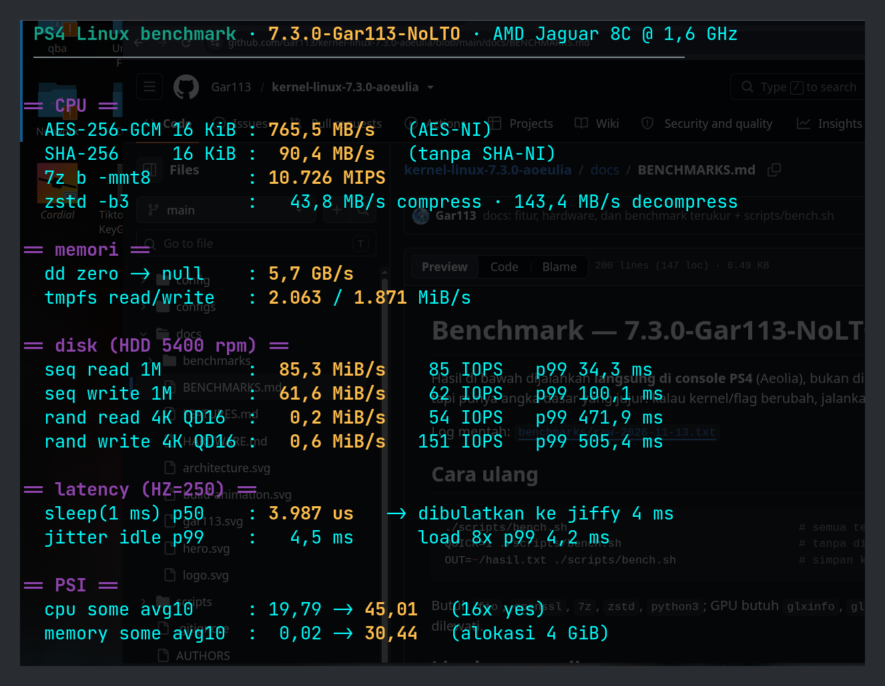

# Benchmark — 7.3.0-Gar113-NoLTO di PS4

Hasil di bawah dijalankan **langsung di console PS4** (Aeolia), bukan di VM.
Tujuannya bukan memenangkan skor, tapi punya angka dasar yang jujur: kalau
kernel/flag berubah, jalankan ulang skrip yang sama dan bandingkan.

Log mentah: [`benchmarks/raw-2026-11-13.txt`](benchmarks/raw-2026-11-13.txt)

<div align="center">
  
</div>

## Cara ulang

```bash
./scripts/bench.sh                                  # semua tes (~3 menit)
QUICK=1 ./scripts/bench.sh                          # tanpa disk + GPU
OUT=~/hasil.txt ./scripts/bench.sh                  # simpan ke path lain
```

Butuh `fio`, `openssl`, `7z`, `zstd`, `python3`; GPU butuh `glxinfo`,
`glmark2`, `vkmark`. Yang tidak ada otomatis dilewati.

## Lingkungan uji

| Hal | Nilai |
|:--|:--|
| Kernel | `7.3.0-Gar113-NoLTO` (#2 SMP PREEMPT_DYNAMIC, clang 19.1.7) |
| CPU | AMD Jaguar 8C/8T @ 1,6 GHz, governor `performance` |
| GPU | Liverpool 18 CU, Mesa 25.1.0-devel, **DPM off** (strap clock) |
| RAM | 5,8 GiB terlihat Linux, zram swap 4 GiB (lz4) |
| Disk | HGST HTS545050A7E680 500 GB **5400 rpm**, ext4, `mq-deadline` |
| Suhu | ~72 °C saat benchmark |
| Sesi | Wayland (Plasma 6), glmark2 lewat XWayland `:1` |

Angka bisa bergeser ±5–15% antar run (thermal, background load, HDD).
Yang penting adalah **perbandingan relatif** saat mengganti kernel/flag.

<div align="center">
  
</div>

---

## CPU

### OpenSSL (2 detik per algoritma, 1000 byte/detik)

| Algoritma | 16 B | 256 B | 8 KiB | 16 KiB |
|:--|--:|--:|--:|--:|
| AES-256-GCM | 15,3 MB/s | 143,1 MB/s | 722,7 MB/s | **765,5 MB/s** |
| SHA-256 | 12,8 MB/s | 63,2 MB/s | 90,1 MB/s | **90,4 MB/s** |
| ChaCha20-Poly1305 | 61,9 MB/s | 217,3 MB/s | 261,1 MB/s | **262,0 MB/s** |

AES cepat karena AES-NI; SHA-256 lambat karena Jaguar **tidak punya SHA-NI**.
Kalau butuh hashing cepat, pakai BLAKE2/BLAKE3 (lebih ramah CPU tanpa SHA-NI).

### Kompresi & integer

| Tes | Hasil |
|:--|:--|
| `7z b -mmt8` | **10.726 MIPS** total (compress 8.599 / decompress 9.047) |
| `zstd -b3` | 43,8 MB/s compress · 143,4 MB/s decompress |
| `zstd -b19` | 0,49 MB/s compress · 106,6 MB/s decompress |

Level 19 memang lambat di 8 core 1,6 GHz — pakai `-3`/`-6` untuk kerja nyata.

---

## Memori

| Tes | Hasil |
|:--|:--|
| `dd` `/dev/zero` → `/dev/null`, 4 GiB, bs=1M | **5,7 GB/s** (5,3 GiB/s) |
| fio tmpfs read, 512 MiB, bs=1M | **2.063 MiB/s** |
| fio tmpfs write, 512 MiB, bs=1M | **1.871 MiB/s** |

`dd` mengukur copy di cache (bukan GDDR5 mentah), tmpfs mengukur jalur
page-cache. Untuk bandwidth RAM asli butuh `mbw`/`tinymembench`; keduanya
tidak terpasang di image ini.

---

## Disk (HDD 5400 rpm, ext4, direct I/O)

| Tes | Bandwidth | IOPS | Latensi p99 |
|:--|--:|--:|--:|
| Sequential read 1M | **85,3 MiB/s** | 85 | 34,3 ms |
| Sequential write 1M | **61,6 MiB/s** | 62 | 100,1 ms |
| Random read 4K (QD16) | 0,2 MiB/s | **54** | 471,9 ms |
| Random write 4K (QD16) | 0,6 MiB/s | **151** | 505,4 ms |

Ini angka HDD 2,5" 5400 rpm yang wajar — dan alasan desktop terasa lambat
saat `updatedb`/build. Solusi: SSD SATA, atau enclosure NVMe USB 3.0
(JMS583 sudah terdeteksi di bus 002).

Catatan: `bfq` tersedia tapi tidak aktif. Untuk HDD yang dipakai desktop
interaktif, BFQ sering lebih enak:

```bash
echo bfq | sudo tee /sys/block/sda/queue/scheduler
```

---

## Latency & timer

### Granularitas `sleep()`

| Diminta | p50 | p99 | max |
|--:|--:|--:|--:|
| 0,5 ms | 3.983 µs | 4.437 µs | 4.501 µs |
| 1 ms | 3.987 µs | 4.508 µs | 5.122 µs |
| 2 ms | 3.990 µs | 5.960 µs | 7.979 µs |
| 5 ms | 7.983 µs | 8.735 µs | 9.224 µs |
| 10 ms | 11.986 µs | 13.941 µs | 14.001 µs |

**Temuan:** sleep dibulatkan ke jiffy (`HZ=250` → 4 ms). Walaupun
`CONFIG_HIGH_RES_TIMERS=y`, platform Aeolia tidak masuk mode high-res
(tidak ada `Switched to high resolution mode` di dmesg; clockevent
di-broadcast lewat PIT). Jadi lantai latency timer ≈ **4 ms**.

### Jitter `sleep(1 ms)`

| Kondisi | avg | p50 | p95 | p99 | max |
|:--|--:|--:|--:|--:|--:|
| Idle | 3.761 µs | 3.985 | 4.100 | 4.507 | 6.478 µs |
| 8× beban CPU (`yes`) | 3.993 µs | 3.990 | 4.136 | 4.222 | 8.043 µs |

Beban CPU tidak menambah p99 secara berarti — preemption penuh
(`CONFIG_PREEMPT=y` + `PREEMPT_DYNAMIC`) bekerja. Yang membatasi tetap
granularitas timer, bukan scheduler.

Butuh lebih halus? Build dengan `CONFIG_HZ=1000` (ongkos: overhead tick
naik, baterai/daya naik — di console tidak masalah).

---

## PSI (Pressure Stall Information)

| Skenario | Sebelum | Puncak |
|:--|--:|--:|
| `cpu some avg10` saat 16× `yes` | 19,79 | **45,01** |
| `memory some avg10` saat alokasi 4 GiB | 0,02 | **30,44** |
| `memory full avg10` saat alokasi 4 GiB | — | 30,29 |

Detail tes memori: 4,00 GiB dialokasikan dalam 17,6 s (233 MiB/s), sisa
`MemAvailable` 548 MiB, swap out **582.753 halaman** (~2,2 GiB), swap in
23.134 halaman. Setelah memori dilepas, PSI turun lagi — artinya sinyal
tekanan benar-benar mengikuti kondisi, bukan counter mati.

Inilah yang dibaca `lmkd` Android/Waydroid untuk memutuskan bunuh proses.

---

## GPU

### glmark2 (XWayland, 1280×720, 3 detik/scene)

| Scene | FPS |
|:--|--:|
| build | 3.326 |
| texture | 4.105 |
| shading | 4.167 |
| jellyfish | 3.105 |
| terrain | 663 |
| **Skor total** | **3.072** |

### vkmark (Wayland, 1280×720, 3 detik/scene)

| Scene | FPS |
|:--|--:|
| vertex | 5.452 |
| texture | 5.385 |
| shading | 5.368 |
| **Skor total** | **5.401** |

`terrain` adalah scene terberat (tessellation/geometri) — wajar drop ke 663
FPS di 18 CU GCN2. Skor antar run: 3.072 / 3.271 / 3.337 (glmark2), variasi
±8%.

**Penting:** semua angka GPU diambil dengan `amdgpu.dpm=0`, jadi GPU berada
di strap clock. Dengan DPM aktif (kalau stabil di revisi Anda), angka bisa
lebih tinggi.

---

## Ringkasan cepat

| Area | Angka kunci |
|:--|:--|
| CPU | AES-GCM 765 MB/s · SHA-256 90 MB/s · 7z 10.726 MIPS |
| Memori | `dd` 5,7 GB/s · tmpfs 2,0 GiB/s |
| Disk | 85 MiB/s seq read · 54 IOPS random 4K |
| Latency | lantai timer 4 ms · jitter p99 4,5 ms |
| PSI | CPU 45,01 · memori 30,44 saat tekanan |
| GPU | glmark2 3.072 · vkmark 5.401 |

## Keterbatasan

- Tidak ada pembanding "kernel lama": kernel sebelumnya sudah tertimpa dan
  tidak pernah dibenchmark. Angka ini adalah **baseline**, bukan delta.
- HDD 5400 rpm membuat tes disk sangat bervariasi; jangan bandingkan angka
  disk antar mesin tanpa menyamakan disk.
- DPM GPU mati → skor GPU bukan kondisi boost.
- Satu run per tes. Untuk klaim serius, jalankan 3× dan ambil median.
- `perf`, `sysbench`, `stress-ng`, `cyclictest` tidak terpasang; penggantinya
  dijelaskan di tiap bagian (openssl/7z/zstd, fio, sleep-jitter, PSI).
