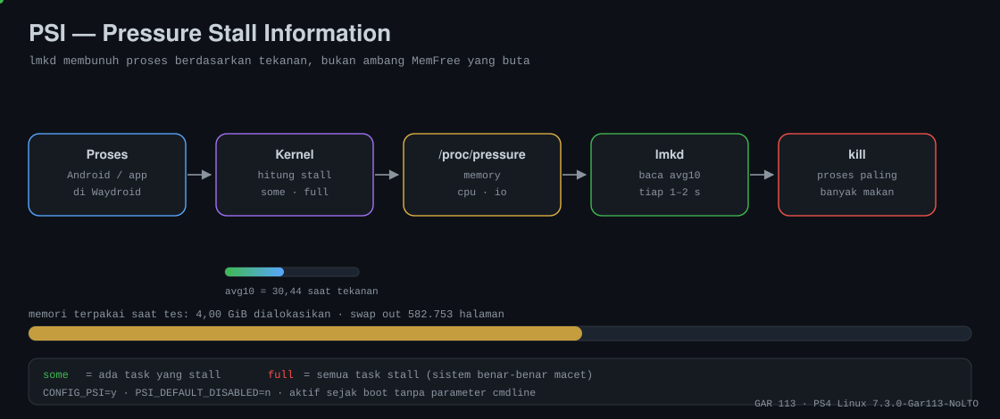
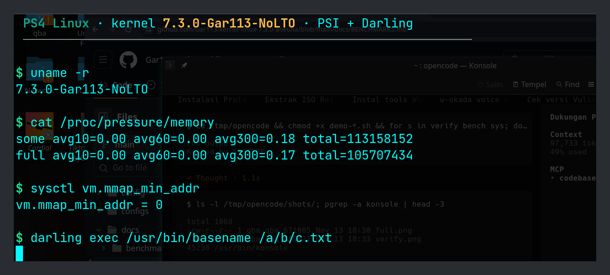

# Fitur kernel

Kernel `7.3.0-Gar113-NoLTO` = Linux 7.3.0 "Strawberry" + PS4/Aeolia support +
PSI + prasyarat Darling + tuning General. Semua simbol di bawah bisa dicek di
`/proc/config.gz` atau [`config/kernel-7.3.0-Gar113-NoLTO.config`](../config/kernel-7.3.0-Gar113-NoLTO.config).

## Ringkasan

| Fitur | Config | Status di mesin uji |
|:--|:--|:--|
| Pressure Stall Information | `CONFIG_PSI=y`, `PSI_DEFAULT_DISABLED=n` | aktif, `/proc/pressure/{cpu,io,memory}` ada |
| Darling (layer macOS) | `configs/darling.cfg` | `darling exec` jalan, prefix overlay ter-mount |
| `mmap` alamat rendah | `DEFAULT_MMAP_MIN_ADDR=0` | `mmap(0x1000)` berhasil |
| Multi-generational LRU | `CONFIG_LRU_GEN=y` | `enabled=0x0007` |
| zram swap | `CONFIG_ZRAM=y` | `/dev/zram0` 4 GiB, lz4 |
| zswap | `CONFIG_ZSWAP=y` | terbangun, **nonaktif** (`zswap.enabled=0`) |
| sched_ext | `CONFIG_SCHED_CLASS_EXT=y` + BTF | tersedia, `state=disabled` (belum ada scheduler) |
| Binder (Android) | `CONFIG_ANDROID_BINDERFS=y` | siap, belum di-mount |
| NTSYNC | `CONFIG_NTSYNC=y` | `/dev/ntsync` ada |
| io_uring | `CONFIG_IO_URING=y` | dipakai fio di benchmark |
| BFQ | `CONFIG_IOSCHED_BFQ=y` | terpasang, disk HDD pakai `mq-deadline` |
| BBR | `CONFIG_TCP_CONG_BBR=y` | tersedia, default `fq_codel` |
| 32-bit | `CONFIG_IA32_EMULATION=y`, `COMPAT_32BIT_TIME=y` | aktif |
| User namespace | `CONFIG_USER_NS=y` | aktif (dibutuhkan Darling/Waydroid) |
| seccomp filter | `CONFIG_SECCOMP_FILTER=y` | aktif |

---

## 1. PSI — Pressure Stall Information

**Kenapa:** `lmkd` di Android (Waydroid) memutuskan proses mana yang dibunuh
berdasarkan *tekanan* memori, bukan ambang `MemFree` yang buta. Di PS4, memori
8 GB dipakai bersama GPU, jadi ambang buta mudah salah bunuh.

<div align="center">
  
</div>

**Config:** `CONFIG_PSI=y`, `CONFIG_PSI_DEFAULT_DISABLED=n` → aktif sejak boot,
tanpa `psi=1` di cmdline.

**Cek:**

```console
$ ls /proc/pressure
cpu  io  memory
$ cat /proc/pressure/memory
some avg10=0.00 avg60=1.05 avg300=3.75 total=113120025
full avg10=0.00 avg60=1.04 avg300=3.66 total=105674490
```

`some` = ada task yang stall, `full` = semua task stall. Angka `avg10/60/300`
dalam persen waktu, `total` dalam mikrodetik kumulatif.

**Per cgroup** (yang dibaca lmkd):

```console
$ cat /sys/fs/cgroup/<grup>/memory.pressure
some avg10=... full avg10=...
```

**Bukti dari benchmark** (lihat [BENCHMARKS.md](BENCHMARKS.md)):

| Skenario | PSI |
|:--|:--|
| CPU idle → 16 proses `yes` | `cpu some avg10` 19,79 → **45,01** |
| Alokasi 4 GiB sampai `MemAvailable` < 550 MiB | `memory some avg10` puncak **30,44** (full 30,29) |

---

## 2. Prasyarat Darling

Darling ≥ 0.1 tidak lagi memakai kernel module: Mach/XNU dijalankan di
userspace (`darlingserver` + `mldr`). Kernel hanya perlu menyediakan namespace,
overlayfs, dan beberapa syscall. Fragmen: [`configs/darling.cfg`](../configs/darling.cfg).

| Simbol | Nilai | Untuk apa |
|:--|:--|:--|
| `CONFIG_DEFAULT_MMAP_MIN_ADDR` | `0` | Mach-O lama map `__TEXT` di `0x1000` |
| `CONFIG_NAMESPACES` + `UTS/IPC/PID/NET/USER_NS` | `y` | prefix terisolasi |
| `CONFIG_OVERLAY_FS`, `CONFIG_TMPFS_XATTR` | `y` | `~/.darling` = overlay di atas `/usr/libexec/darling` |
| `CONFIG_USERFAULTFD` | `y` | `darlingserver` (manajemen page) |
| `CONFIG_MEMFD_CREATE`, `CONFIG_CROSS_MEMORY_ATTACH`, `CONFIG_KCMP` | `y` | shared memory + inspeksi proses |
| `CONFIG_FUSE_FS`, `CONFIG_BLK_DEV_LOOP` | `y` | image/DMG |
| `CONFIG_BINFMT_MISC`, `CONFIG_SECCOMP_FILTER` | `y` | loader + sandbox |
| `CONFIG_IA32_EMULATION`, `CONFIG_COMPAT_32BIT_TIME` | `y` | binary 32-bit |
| `CONFIG_DEBUG_INFO_BTF` | `y` | tracepoint/BPF yang dipakai tooling Darling |

**Cek:**

```console
$ sysctl vm.mmap_min_addr
vm.mmap_min_addr = 0
$ darling exec /usr/bin/basename /a/b/c.txt
c.txt
$ darling exec /bin/mount | grep overlay
overlay on /home/qba/.darling type overlay (rw,relatime,
  lowerdir=/usr/libexec/darling, upperdir=/home/qba/.darling,
  workdir=/home/qba/.darling.workdir)
```

`mmap` di `0x1000` (yang dulu diblokir):

```python
import ctypes, ctypes.util
libc = ctypes.CDLL(ctypes.util.find_library("c"), use_errno=True)
libc.mmap.restype = ctypes.c_void_p
p = libc.mmap(ctypes.c_void_p(0x1000), 4096, 3, 0x02 | 0x10 | 0x20, -1, 0)
print(hex(p))     # 0x1000
```

### Trade-off keamanan `mmap_min_addr=0`

Alamat rendah jadi bisa di-map, artinya bug NULL-pointer dereference bisa
dijadikan eksploit (kelas CVE-2009-2692). Ini **syarat Darling**, bukan
kelonggaran umum. Kalau tidak sedang memakai Darling, kembalikan:

```bash
sudo sysctl -w vm.mmap_min_addr=65536      # langsung, tanpa reboot
```

atau hapus barisnya dari `configs/darling.cfg` lalu build ulang.

---

## 3. Manajemen memori

| Fitur | Config | Efek |
|:--|:--|:--|
| MGLRU | `LRU_GEN=y`, `LRU_GEN_ENABLED=y` | reclaim lebih pintar, penting saat 8 GB dipakai GPU + game |
| zram | `ZRAM=y` (default comp `zstd`) | swap terkompresi di RAM; di mesin ini `/dev/zram0` 4 GiB **lz4** |
| zswap | `ZSWAP=y` | cache swap terkompresi; **nonaktif** karena sudah ada zram |
| THP | `TRANSPARENT_HUGEPAGE=y` + `MADVISE` | hanya lewat `madvise()`, tidak agresif |
| KSM | `KSM=y` | dedup halaman (Waydroid/VM) |

```console
$ cat /sys/kernel/mm/lru_gen/enabled
0x0007
$ zramctl
NAME       ALGORITHM DISKSIZE   DATA  COMPR  TOTAL STREAMS MOUNTPOINT
/dev/zram0 lz4             4G 911,5M 315,7M  ...        [SWAP]
$ cat /sys/module/zswap/parameters/enabled
N
```

zram + zswap sebaiknya **jangan** dua-duanya: pilih salah satu. Di sini zram
dipakai sebagai swap utama, zswap dimatikan supaya tidak double-compress.

---

## 4. Scheduler, preemption, timer

| Simbol | Nilai | Catatan |
|:--|:--|:--|
| `CONFIG_PREEMPT` | `y` | preemptible penuh |
| `CONFIG_PREEMPT_DYNAMIC` | `y` | mode bisa diganti runtime (voluntary/full) |
| `CONFIG_HZ` | `250` | kompromi latency vs overhead |
| `CONFIG_NO_HZ_FULL` | `y` | dynticks tersedia (butuh `nohz_full=`) |
| `CONFIG_SCHED_CLASS_EXT` | `y` | sched_ext untuk scheduler BPF (`scx_*`) |
| `CONFIG_DEBUG_INFO_BTF` | `y` | `/sys/kernel/btf/vmlinux` ada |

**sched_ext** siap tapi belum ada scheduler yang dimuat:

```console
$ cat /sys/kernel/sched_ext/state
disabled
$ cat /sys/kernel/sched_ext/nr_rejected
0
```

Muat scheduler userspace (contoh `scx_lavd`) → `state` berubah jadi `enabled`,
dan `/sys/kernel/sched_ext/root/ops` menampilkan nama scheduler.

**Granularitas timer — temuan penting.** Walaupun `CONFIG_HIGH_RES_TIMERS=y`,
di platform Aeolia sleep dibulatkan ke jiffy (1/250 s = 4 ms):

| `sleep()` diminta | p50 terukur |
|:--|:--|
| 0,5 ms | 3.983 µs |
| 1 ms | 3.987 µs |
| 2 ms | 3.990 µs |
| 5 ms | 7.983 µs |
| 10 ms | 11.986 µs |

Artinya **lantai latency timer ≈ 4 ms**, dan jitter idle ≈ 4 ms (p99 4,5 ms).
`PREEMPT_DYNAMIC` tidak mengubah ini — ini batas clockevent, bukan preemption.
Kalau butuh granularitas lebih halus, naikkan `CONFIG_HZ` ke 1000 saat build
(ongkos: overhead tick lebih besar).

---

## 5. I/O dan jaringan

| Fitur | Config | Status |
|:--|:--|:--|
| io_uring | `IO_URING=y` | dipakai fio (`--ioengine=io_uring`) |
| BFQ | `IOSCHED_BFQ=y` | terpasang; disk ini memakai `mq-deadline` (cocok untuk HDD) |
| mq-deadline | `MQ_IOSCHED_DEADLINE=y` | aktif (`[mq-deadline]`) |
| fq_codel | `DEFAULT_NET_SCH="fq_codel"` | qdisc default |
| BBR | `TCP_CONG_BBR=y` | tinggal `sysctl net.ipv4.tcp_congestion_control=bbr` |
| veth/bridge/tun | `y` | Waydroid, container, Tailscale |

```console
$ cat /sys/block/sda/queue/scheduler
none [mq-deadline] kyber bfq
```

BFQ lebih berguna untuk HDD yang dipakai desktop interaktif; ganti dengan
`echo bfq | sudo tee /sys/block/sda/queue/scheduler` kalau mau membandingkan.

---

## 6. Android / Waydroid

- `CONFIG_ANDROID_BINDERFS=y` + `CONFIG_ANDROID_BINDER_IPC=y` → `binderfs`
- `CONFIG_MEMCG=y` + cgroup v2 → `memory.pressure`, `memory.max`, `memory.current`
- PSI → `lmkd` bisa reaktif
- Waydroid modern memakai `memfd` (bukan ashmem), jadi `CONFIG_ASHMEM` tidak perlu

Mount binderfs:

```bash
sudo mkdir -p /dev/binderfs
sudo mount -t binder binder /dev/binderfs
```

---

## 7. Wine / Proton / gaming

| Fitur | Config | Efek |
|:--|:--|:--|
| NTSYNC | `NTSYNC=y` | `/dev/ntsync`, sinkronisasi thread ala Windows tanpa esync/fsync |
| futex2 | `FUTEX2`/`FUTEX_WAIT_MULTIPLE` | dipakai Proton terbaru |
| 32-bit | `IA32_EMULATION=y` | game/binary 32-bit |

---

## 8. Verifikasi cepat

<div align="center">
  
</div>

```bash
./scripts/verify-kernel.sh          # PSI + prasyarat Darling
./scripts/bench.sh                  # benchmark lengkap (lihat BENCHMARKS.md)
```

Manual:

```bash
uname -r                                    # 7.3.0-Gar113-NoLTO
cat /proc/pressure/memory
sysctl vm.mmap_min_addr
zramctl
cat /sys/kernel/mm/lru_gen/enabled
cat /sys/kernel/sched_ext/state
ls /sys/kernel/btf/vmlinux
ls /dev/ntsync
```
