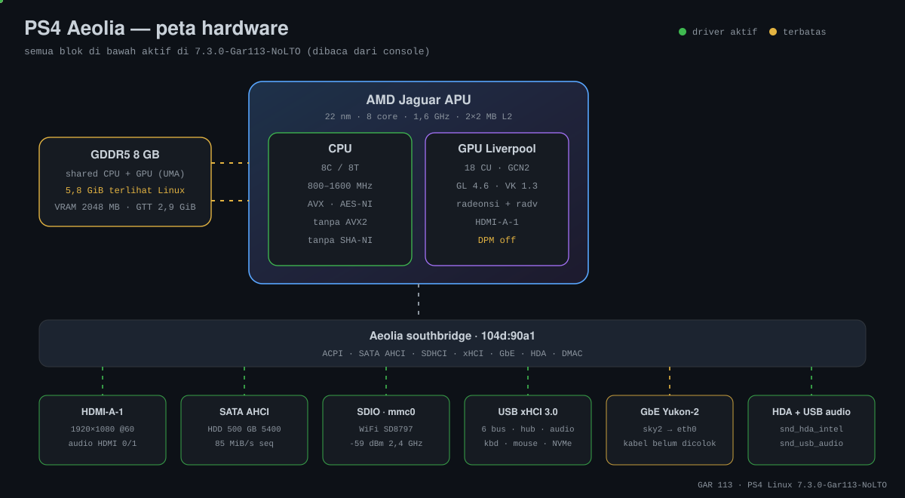
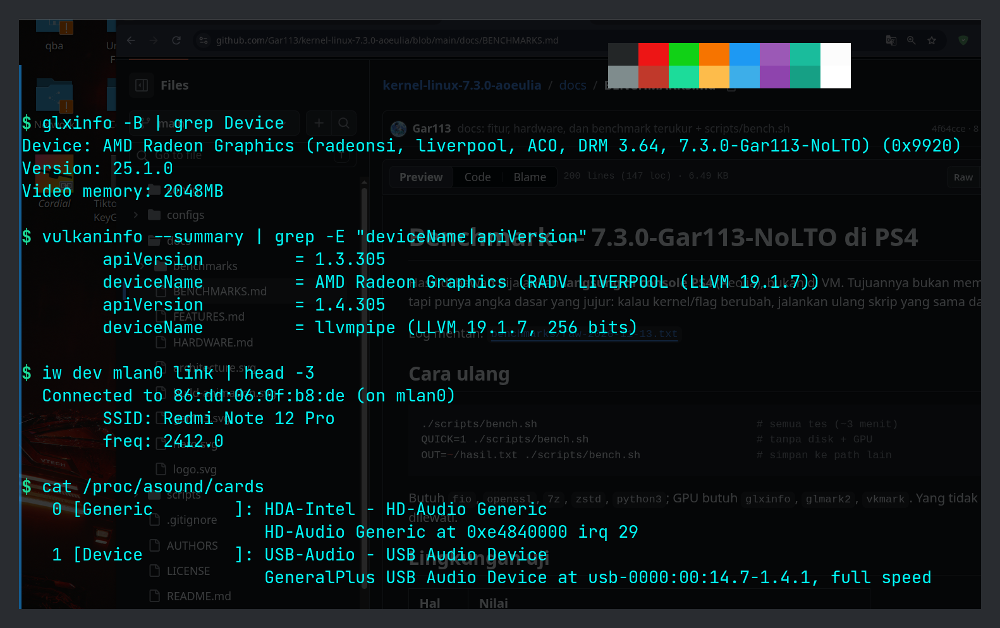

# Dukungan hardware — PS4 Aeolia

Semua angka di sini diambil dari console yang benar-benar menjalankan
`7.3.0-Gar113-NoLTO` (bukan dari spesifikasi di Wikipedia). Perintah
verifikasinya disertakan supaya bisa diulang di mesin lain.

## Ringkasan mesin

<div align="center">
  
</div>

| Komponen | Isi | Driver / status |
|:--|:--|:--|
| APU | AMD Jaguar 8 core / 8 thread @ 1,6 GHz | `k10temp`, `ps4_cpufreq`, jalan |
| GPU | Radeon GCN2 "Liverpool", 18 CU | `amdgpu` + `radeonsi` / `radv`, jalan |
| Memori | 8 GB GDDR5 shared (UMA) | Linux melihat 5,8 GiB, jalan |
| Storage | SATA AHCI + HDD 500 GB 5400 rpm | `ahci`, `sd`, jalan |
| Optical | Blu-ray SONY PS-SYSTEM 402R | `sr0`, terdeteksi |
| SD/MMC | Aeolia SDHCI (mmc0) | `sdhci`, jalan |
| WiFi | Marvell SD8797 via SDIO (mmc0:0001) | `mwifiex_sdio` → `mlan0`, jalan |
| Ethernet | Marvell Yukon-2 OptimaEEE | `sky2` → `eth0`, jalan (kabel belum dicolok) |
| USB | xHCI 3.0 (6 bus) | `xhci_hcd`, jalan |
| Audio | HDMI/DP audio + USB audio | `snd_hda_intel`, `snd_usb_audio`, jalan |
| Sensor | suhu APU, fan PS4, daya | `k10temp`, `ps4_fan`, `fam15h_power` |
| Firmware | VBIOS Liverpool + SD8797/MT7668 | dari ROM BAR + `extra_firmware/` |

`uname -r` → `7.3.0-Gar113-NoLTO` · `lspci` root complex `1022:1436` ·
southbridge `Aeolia B1 [104d:90a1]`.

<div align="center">
  
</div>

<sub>Tangkapan layar asli dari console: `fastfetch`, `glxinfo`, `vulkaninfo`,
`iw`, dan `/proc/asound/cards` di mesin uji.</sub>

---

## CPU — AMD Jaguar

```console
$ lscpu
Model name:  AMD Jaguar
CPU(s):      8            Thread(s) per core: 1
CPU max MHz: 1600,0000    CPU min MHz: 800,0000
L2 cache:    4 MiB (2 instance, 2 MiB per 4 core)
Flags:       ... sse4_2 avx aes pclmulqdq movbe popcnt xsave bmi1 ...
```

| Hal | Nilai | Implikasi |
|:--|:--|:--|
| Core/thread | 8C/8T, tanpa SMT | `-j8` build, `-j6` aman untuk desktop |
| AVX | ada, **AVX2 tidak ada** | `-march=btver2` (bukan `x86-64-v3`) |
| AES-NI / PCLMUL | ada | AES-GCM cepat (765 MB/s di 16 KiB) |
| SHA-NI | **tidak ada** | SHA-256 cuma ~90 MB/s di 16 KiB |
| BMI1/BMI2 | BMI1 ada, BMI2 tidak | jangan compile `-mbmi2` |
| Frekuensi | 800–1600 MHz, governor `performance` | benchmark = clock tertinggi |

`CONFIG_PS4_CPUFREQ=y` membuat `cpufreq` bisa jalan; governor `performance`
dipakai di mesin uji supaya angka benchmark tidak melompat-lompat.

---

## GPU — Liverpool (GCN2)

```console
$ journalctl -k | grep -E "SE 2|VRAM:|Liverpool CLK"
amdgpu: SE 2, SH per SE 1, CU per SH 9, active_cu_number 18
amdgpu: VRAM: 2048M 0x0000000F00000000 - 0x0000000F7FFFFFFF (2048M used)
amdgpu: Liverpool CLK: ... DYNAMIC_PM_EN=0
amdgpu: Liverpool CLK: failed to force DID=1 after 5 attempts - GPU stays at strap clock.
$ glxinfo -B
Device: AMD Radeon Graphics (radeonsi, liverpool, ACO, DRM 3.64, 7.3.0-Gar113-NoLTO)
Version: 25.1.0     Max core profile version: 4.6     Video memory: 2048MB
$ vulkaninfo --summary
deviceName = AMD Radeon Graphics (RADV LIVERPOOL (LLVM 19.1.7))
apiVersion = 1.3.305      driverName = radv
```

| Hal | Nilai |
|:--|:--|
| IP block | `gfx_v7_1_0`, `gmc_v7_0_0`, `dce_v8_1_0`, `sdma_v2_0_0` |
| CU | 18 (2 SE × 1 SH × 9 CU), 1,84 TFLOPS FP32 (teori) |
| VRAM | 2048 MB terlihat kernel, GTT 2,9 GiB |
| OpenGL | 4.6 core (Mesa 25.1.0-devel, ACO) |
| Vulkan | 1.3.305 (radv, LLVM 19.1.7) |
| Output | `HDMI-A-1` saja (tanpa DisplayPort) |
| Power management | **DPM dimatikan** lewat cmdline `radeon.dpm=0 amdgpu.dpm=0` |

**Penting:** dengan `amdgpu.dpm=0`, kernel tidak menaikkan clock GPU secara
dinamis — GPU tetap di *strap clock*. Ini disengaja untuk stabilitas di PS4
(firmware SMC tidak lengkap), tapi artinya:

- skor GPU di benchmark = kondisi clock tetap, bukan boost;
- konsumsi daya dan suhu lebih tinggi dari yang perlu saat idle;
- jangan harap angka sama dengan PS4 yang memakai DPM.

Untuk mencoba DPM: hapus `radeon.dpm=0 amdgpu.dpm=0` dari cmdline. Kalau
gambar korup/hang, kembalikan — banyak revisi Aeolia memang tidak stabil
dengan DPM aktif.

---

## Memori — 8 GB GDDR5 shared

| Hal | Nilai |
|:--|:--|
| Fisik | 8 GB GDDR5, dipakai CPU + GPU (UMA) |
| Dilihat Linux | 5,8 GiB `MemTotal` (sisanya carve-out GPU/secure) |
| VRAM | 2048 MB (`mem_info_vram_total`), GTT 2,9 GiB |
| Swap | zram 4 GiB (lz4) + bisa tambah swapfile |
| Bandwidth ukur | 5,7 GB/s `dd` zero→null, 2,0 GiB/s tmpfs |

Karena UMA, "VRAM" dan "RAM" berebut bandwidth yang sama. Saat game/GPU
berat, CPU ikut melambat — ini karakter PS4, bukan bug kernel.

```console
$ free -h
               total        used        free      shared  buff/cache   available
Mem:           5,8Gi       3,2Gi       1,1Gi       284Mi       2,0Gi       2,5Gi
Swap:          5,0Gi       0,0Gi       5,0Gi     # zram 4G + file 1G
```

---

## Storage

```console
$ lsblk -o NAME,SIZE,FSTYPE,MOUNTPOINT,MODEL
sda    465,8G                       HGST HTS545050A7E680
├─sda1    77M vfat   /boot          # bzImage di sini
└─sda2 465,7G ext4   /
sr0     1024M                       SONY PS-SYSTEM 402R
zram0      4G swap   [SWAP]
```

| Hal | Nilai |
|:--|:--|
| Controller | Aeolia SATA AHCI (`ahci`) |
| Disk | HGST HTS545050A7E680, 500 GB, **5400 rpm** (rotational=1) |
| Scheduler | `mq-deadline` (BFQ tersedia, tinggal ganti) |
| Partisi boot | `sda1` FAT32 77 MB — tempat `bzImage` |
| Optical | Blu-ray SONY PS-SYSTEM 402R (`sr0`) |

HDD 5400 rpm adalah **bottleneck utama** mesin ini: sequential ~85 MB/s,
random 4K cuma ~54 IOPS. Itu sebabnya angka disk di
[BENCHMARKS.md](BENCHMARKS.md) terlihat kecil — bukan salah kernel.
SSD SATA (atau USB 3.0 SSD lewat JMS583, yang terdeteksi di bus 002) akan
jauh lebih cepat.

---

## USB

```console
$ lsusb
Bus 001: Genesys Logic Hub / Huasheng USB2.0 HUB
         Generalplus USB Audio Device
         Silicon Labs USB OPTICAL MOUSE
         USB usb keyboard
Bus 002: Genesys Logic Hub
         JMicron JMS583Gen 2 to PCIe Gen3x2 Bridge   # enclosure NVMe
```

- xHCI 3.0, 6 bus (2 SS + 4 HS), hotplug jalan.
- Keyboard, mouse, USB audio, hub, enclosure NVMe semuanya terdeteksi.
- Port depan PS4 = USB 3.0; port belakang = USB 3.0 juga (tergantung revisi).

---

## Jaringan

| Interface | Driver | Status |
|:--|:--|:--|
| `eth0` | `sky2` (Yukon-2 OptimaEEE) | up, `NO-CARRIER` (kabel belum dicolok) |
| `mlan0` | `mwifiex_sdio` (Marvell SD8797 di mmc0) | **connected**, 2,4 GHz, -59 dBm |
| `tailscale0` | `wireguard`/tun | aktif |
| `docker0` | bridge | aktif |

```console
$ iw dev mlan0 link
Connected to 86:dd:06:0f:b8:de
SSID: Redmi Note 12 Pro     freq: 2412.0
signal: -59 dBm             rx bitrate: 52.0 MBit/s
```

WiFi butuh firmware `sd8797_uapsta.bin` (ada di `extra_firmware/`, ikut
tertanam di build). Tanpa firmware, `mlan0` tidak muncul. Beberapa revisi
PS4 memakai MT7668 — driver `mt7663u` juga dibangun, tapi mesin uji ini
memakai SD8797 lewat SDIO.

---

## Audio

```console
$ cat /proc/asound/cards
 0 [Generic]: HDA-Intel - HD-Audio Generic      # HDMI/DP
 1 [Device ]: USB-Audio - USB Audio Device      # GeneralPlus USB
$ aplay -l
card 0, device 3: HDMI 0
card 0, device 7: HDMI 1
card 1, device 0: USB Audio
```

- HDMI audio lewat `snd_hda_intel` (2 output PCM).
- PS4 tidak punya jack analog; audio keluar lewat HDMI atau USB.
- USB audio kelas-compliant langsung jalan tanpa konfigurasi.

---

## Sensor & suhu

```console
$ for h in /sys/class/hwmon/hwmon*/; do echo "$(cat $h/name): $(cat $h/temp1_input 2>/dev/null)"; done
ps4_fan: 72000        # m°C, crit 75 °C
k10temp: 72250        # m°C, crit 100 °C
fam15h_power: (daya)
```

Suhu ~72 °C saat benchmark adalah normal untuk PS4 (fan kurva konsol).
`ps4_fan` mengekspos suhu dan batas kritis; kontrol fan tetap di firmware.
Kalau `k10temp` mendekati 100 °C, berhenti — ventilasi console memang pas-pasan.

---

## Cmdline boot

```text
panic=0 clocksource=tsc consoleblank=0 net.ifnames=0
radeon.dpm=0 amdgpu.dpm=0 drm.debug=0
console=ttyS0,115200n8 console=tty0
video=HDMI-A-1:1920x1080@60
```

| Parameter | Alasan |
|:--|:--|
| `panic=0` | jangan reboot otomatis saat panic — biar bisa dibaca |
| `clocksource=tsc` | TSC stabil di Jaguar, hindari fallback jitter |
| `consoleblank=0` | layar tidak mati saat idle |
| `net.ifnames=0` | nama `eth0`/`mlan0` tetap, bukan `enp…` |
| `radeon.dpm=0 amdgpu.dpm=0` | matikan DPM (stabilitas Aeolia) |
| `drm.debug=0` | log DRM tidak banjir |
| `console=ttyS0,115200n8` | debug serial (kalau ada adaptor) |
| `video=HDMI-A-1:1920x1080@60` | mode aman, tidak bergantung EDID TV |

---

## Yang jalan / belum

| Kemampuan | Status | Catatan |
|:--|:--|:--|
| Desktop Wayland (Plasma 6) | ✅ | `radeonsi`, XWayland untuk app GTK lama |
| OpenGL 4.6 / Vulkan 1.3 | ✅ | glmark2 + vkmark jalan |
| Video decode (VCN/UVD) | ⚠️ | GCN2 punya UVD; `amdgpu` di Liverpool terbatas, pakai decode software |
| WiFi 2,4 GHz | ✅ | SD8797, 5 GHz tergantung region/AP |
| Ethernet GbE | ✅ | driver siap, uji dengan kabel |
| HDMI audio | ✅ | 2 PCM HDMI |
| USB audio | ✅ | kelas-compliant |
| Blu-ray drive | ✅ | terdeteksi `sr0` (putar BD butuh library userspace) |
| SD/MMC | ✅ | host mmc0 dipakai WiFi; slot kartu tidak diuji |
| Sensor suhu/daya | ✅ | `k10temp`, `ps4_fan`, `fam15h_power` |
| Fan control manual | ❌ | kurva fan di firmware |
| Suspend/resume | ⚠️ | tidak diuji di build ini |
| DPM GPU | ⚠️ | dimatikan; bisa dicoba dengan risiko hang |

Kalau ada komponen yang tidak muncul, cek dulu `dmesg | grep -i aeolia`
dan pastikan firmware di `extra_firmware/` ikut terpasang.
